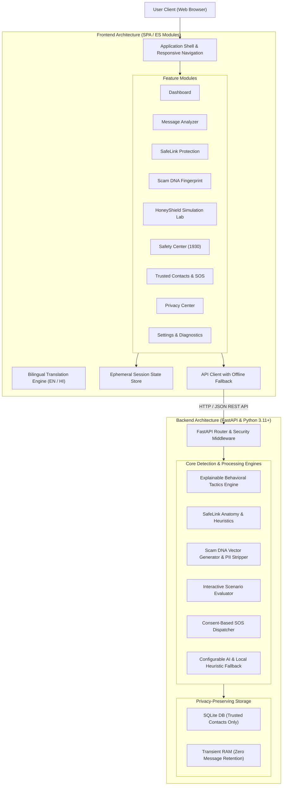

# ScamSaathi — Technical Architecture & Engineering Design
**Tagline:** Pause. Verify. Protect.  
**Team:** CTRL+FREAKS  
**Category:** AI-Assisted Cybersecurity & Scam Prevention

---

## 1. High-Level System Architecture

---

## 2. Core Detection & Scoring Architecture

ScamSaathi implements an **explainable, multi-axis heuristic and behavioral scoring engine** rather than a black-box percentage score:

### 2.1 Psychological Manipulation Axes
1. **Urgency & Time Pressure:** Detects artificial deadlines (`immediately`, `within 10 minutes`, `turant`, `aaj raat`).
2. **Fear & Coercion:** Detects threats of legal penalty, power cuts, or arrest (`account blocked`, `electricity disconnected`, `warrant`, `khata band`).
3. **False Authority:** Detects impersonation of trusted authorities (`SBI`, `CBI`, `Cyber Crime`, `TRAI`, `Police`).
4. **Secrecy & Isolation:** Detects commands isolating the victim from second opinions (`keep confidential`, `stay on video call`, `kisi ko mat batana`).
5. **Reward & Enticement:** Identifies unsolicited lottery and task schemes (`KBC winner`, `part-time tasks`, `25 Lakhs`).
6. **Credential Theft:** Flags demands for OTPs, UPI PINs, or processing fees.
7. **Technical Deception:** Detects unauthorized APK installations (`.apk`, `AnyDesk`, `TeamViewer`).

### 2.2 Risk Categorization Thresholds
- **0–24 (LOW):** Normal benign notifications or routine reminders.
- **25–54 (MEDIUM):** Unverified links or mildly pressured language. Independent confirmation recommended.
- **55–79 (HIGH):** Prominent coercion, spoofed authority, or suspicious URL structure.
- **80–100 (CRITICAL):** Direct credential harvesting, threat of immediate disconnection, or malicious APK distribution.

### 2.3 Contextual Behavioral Interventions
When high urgency combined with fear or credential requests is detected, the **"Pause Before You Act"** modal interrupts the user's emotional state, delivering supportive, blame-free protective advice.

---

## 3. SafeLink Protection Architecture

SafeLink inspects user-submitted URLs through progressive checks:
1. **URL Syntax Parsing:** Strict validation using `urllib.parse` to prevent malformed strings.
2. **Dangerous Schemes:** Flags `javascript:`, `data:`, and `file:` protocols.
3. **Transport Security:** Evaluates HTTP vs HTTPS encryption.
4. **Host Format:** Detects raw numerical IP hosts (e.g. `http://192.168.1.1/` or `http://185.220.101.5/`).
5. **Brand Spoofing & Lookalikes:** Evaluates keywords of popular Indian banks and payment portals (SBI, HDFC, Paytm, PhonePe, India Post).
6. **URL Shorteners:** Detects redirection masking (Bitly, TinyURL, is.gd, etc.).
7. **Top-Level Domains:** Inspects frequently abused disposable TLDs (`.xyz`, `.top`, `.buzz`, `.online`).
8. **Direct Binary / APK Targets:** Identifies `.apk` and `.exe` downloads.
9. **Safe Interstitial Preview:** Never loads untrusted URLs directly into unrestricted iframes or automated sandboxes; provides clear domain verification before any user-confirmed navigation.

---

## 4. Scam DNA & PII Scrubbing

The **Scam DNA** module generates an 8-axis radar vector representing the anatomy of the scam.

Before any export (as PNG image or copyable text summary):
- Raw message text is stripped.
- Phone numbers (`+91 ...`, 10-digit integers) are replaced with `[PHONE REDACTED]`.
- Email addresses are scrubbed with `[EMAIL REDACTED]`.
- Destination URLs are sanitized with `[URL REMOVED]`.
- Authentication codes (OTPs, PINs) are scrubbed with `[CODE REDACTED]`.

---

## 5. Security & Privacy Guarantees

- **Zero-Message-Retention:** Analyzed message content is stored only in transient memory during request processing and never written to SQLite, logs, or disk.
- **Sanitized Logging:** Application logs do not output submitted messages or personal contacts.
- **No Third-Party Trackers:** Zero external telemetry, cookies, or marketing trackers.
- **Safe Fallback Modes:** If external AI (OpenAI/Gemini), Safe Browsing, or Twilio SMS credentials are not configured, ScamSaathi gracefully falls back to deterministic local rule engines and safe demo simulation.
